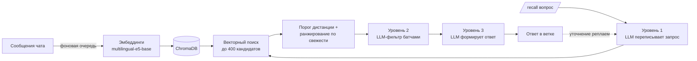

# ComicBot

Telegram-бот для групповых чатов: рисует комиксы по свежей переписке, делает выжимки обсуждений и отвечает на вопросы по всей истории чата с помощью RAG — векторного поиска и многоуровневой обработки запроса несколькими LLM.

**Стек:** Python 3.11+, asyncio, Pyrogram, Playwright (Gemini / Nano Banana), ChromaDB, sentence-transformers (`multilingual-e5-base`), локальная LLM через OpenAI-совместимый API (LM Studio, Qwen), FastAPI + uvicorn (веб-панель).

---

## Возможности

| Команда | Что делает |
|---|---|
| ключевое слово «комикс» / `/comic` | Берёт последние N сообщений и генерирует комикс по ним. Стиль выбирается случайно или кнопкой (Рик и Морти, «Тайна третьей планеты», средневековый манускрипт и др. — задаются в `config.yaml`, можно с картинкой-референсом персонажа) |
| `/recall <вопрос>` | **Поиск по всей истории чата** через RAG (см. ниже). Ответы на сообщение бота — уточняющие вопросы в той же ветке |
| `/summary`, `/summary50`, `/summary_all` … | Выжимка последних 20/50/100/N сообщений |
| `/ask <вопрос>` | Развёрнутый ответ «архитектора» с учётом контекста последних сообщений |
| `/sticker` | Превращает картинку в стикер и добавляет в стикерпак бота |
| `/passive` | Пассивный режим: бот сам вставляет реплику раз в N сообщений |

Плюс веб-панель на `http://localhost:8091`: история, разрешённые чаты, ручной запуск генерации, импорт переписки, скопированной из Telegram Desktop.

---

## Поиск по истории: RAG с многоуровневой обработкой

Команда `/recall` отвечает на вопросы вроде «что мы решили по деплою в сентябре?». Запрос проходит через несколько уровней ИИ: каждый следующий работает с более узким и точным контекстом.



**Индексация.** Каждое сообщение группы длиннее 8 символов попадает в фоновую очередь: отдельный поток кодирует его моделью `intfloat/multilingual-e5-base` (с префиксами `passage:` / `query:`, как требует e5) и записывает в ChromaDB, не блокируя event loop бота. При первом запуске база заполняется из сохранённой истории. При смене модели эмбеддингов создаётся новая коллекция, старые векторы не смешиваются с новыми.

**Уровень 1 — переписывание запроса.** Уточняющий вопрос в ветке («а кто это предложил?») сам по себе для поиска бесполезен. Локальная LLM получает контекст ветки и превращает его в самостоятельный поисковый запрос.

**Векторный поиск и ранжирование.** Из ChromaDB извлекается до 400 ближайших сообщений, кандидаты с косинусной дистанцией выше порога (`rag_max_distance`) отбрасываются. Оставшиеся ранжируются по комбинированному скору: релевантность + свежесть с весом `rag_recency_weight`, чтобы при прочих равных побеждали недавние сообщения.

**Уровень 2 — LLM-фильтр.** Векторная близость — не то же самое, что релевантность. Локальная LLM просматривает кандидатов батчами по 100 (сообщения обрезаются, чтобы не переполнить контекст) и оставляет только действительно отвечающие на вопрос — до 150 штук. Если фильтр сбоит, используется fallback на топ по вектору.

**Уровень 3 — ответ.** Отфильтрованные сообщения сортируются хронологически и передаются Gemini или локальной LLM (`rag_use_local_llm_for_response`) вместе с вопросом и историей ветки. Ответ привязывается к ветке на `recall_thread_ttl` секунд: реплаи на него запускают конвейер заново уже с контекстом диалога.

Все пороги и лимиты вынесены в `config.yaml` и подбираются по логам («оставлено / отброшено»). `phoenix_view.py` выгружает векторы в формат TensorFlow Projector для визуальной отладки базы.

---

## Архитектура

```
bot.py          — точка входа: Pyrogram-клиент, запуск RAG-воркера и веб-панели
handlers.py     — обработчики команд, кулдауны, ветки /recall, пассивный режим
gemini_web.py   — работа с Gemini через Playwright: очередь генераций, ретраи,
                  восстановление сессии, скачивание картинок, отладочные снапшоты
rag.py          — индексация, векторный поиск, ранжирование, LLM-уровни
history.py      — локальная история сообщений по чатам
bot_messages.py — журнал отправленных ботом сообщений
web_ui.py       — FastAPI-панель управления
config.py       — загрузка .env и config.yaml в типизированный Settings
```

Gemini используется через автоматизацию веб-интерфейса (headless Chrome + Playwright) — так доступна генерация изображений Nano Banana. Запросы сериализуются через asyncio-lock, при падении браузера он перезапускается, при вылете из аккаунта бот шлёт алерт администратору.

---

## Запуск

```bash
pip install -r requirements.txt
playwright install chromium
cp .env.example .env        # заполнить ключи
python setup_login.py       # один раз: войти в Google в открывшемся браузере
python bot.py
```

**Ключи (`.env`):**
- `TELEGRAM_API_ID`, `TELEGRAM_API_HASH` — на https://my.telegram.org → API development tools
- `TELEGRAM_BOT_TOKEN` — у [@BotFather](https://t.me/BotFather), команда `/newbot`
- `GEMINI_WEB_*` — куки gemini.google.com (F12 → Application → Cookies), обязательны `__Secure-1PSID` и `__Secure-1PSIDTS`
- `ADMIN_CHAT_ID` — необязательно, чат для алертов о проблемах с сессией Gemini

**Локальная LLM** (для уровней 1–2 RAG): любой OpenAI-совместимый сервер, например LM Studio с моделью Qwen. Адрес и модель — `local_llm_url` / `local_llm_model` в `config.yaml`.

Боту в группе нужно отключить privacy mode (BotFather → Bot Settings → Group Privacy → Turn off), чтобы он видел все сообщения. Ограничить список групп можно через `allowed_chat_ids`.
